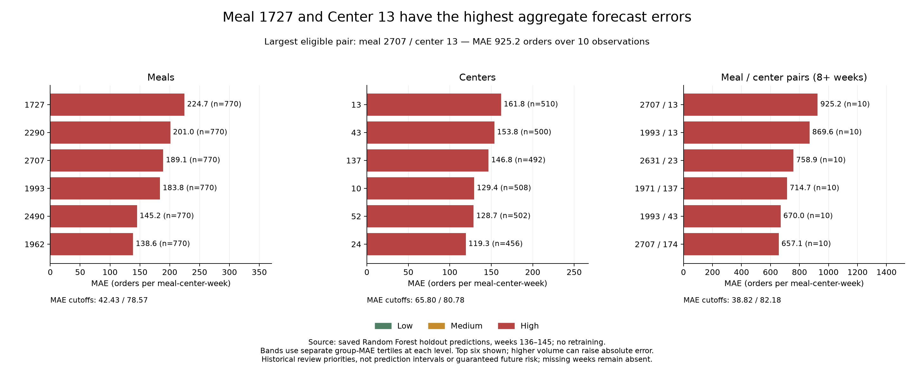

# التقرير التقني لتحليل الطلب على الوجبات

## نظرة عامة على المشروع

يعالج المشروع تحدي تقدير مشتريات الوجبات أسبوعيًا مع اختلاف الطلب بين المراكز والوجبات وتغير العروض والأسعار. الهدف هو وصف الطلب وتركيزه، وفحص ارتباطاته بالترويج والتخفيض، وتحديد أولويات متابعة المخزون، ومقارنة التنبؤ بالاعتماد على طلب الأسبوع السابق.

وحدة الملاحظة هي وجبة محددة في مركز محدد خلال أسبوع مسجل. يتدرج العمل من فحص المصادر وإثرائها إلى التحليل الوصفي، وتعريف المؤشرات، والمقارنات الإحصائية، وتقسيم الوجبات، والتنبؤ، ثم الاختبارات والعرض التفاعلي. هذا التقرير يوثق التنفيذ الفعلي ونتائجه المحفوظة، ولا يعيد نص التقرير الموجه للإدارة.

## مصادر البيانات والعلاقات

| الملف | الصفوف | الأعمدة | الدور |
| --- | ---: | ---: | --- |
| `train.csv` | 456,548 | 9 | الطلب التاريخي للأسابيع 1–145، ويشمل الهدف `num_orders`. |
| `test.csv` | 32,573 | 8 | مدخلات الأسابيع 146–155 بلا طلب فعلي؛ لتوليد التوقعات لا لقياس دقتها. |
| `meal_info.csv` | 51 | 3 | معرّف الوجبة وفئتها ونوع المطبخ؛ لا توجد أسماء خاصة أو أوصاف تفصيلية للوجبات. |
| `fulfilment_center_info.csv` | 77 | 5 | معرّف المركز، ورموز المدينة والمنطقة، وفئة المركز، ومساحة تشغيله. |

المعرّف `id` فريد لكل سجل طلب، والمفتاح المركب `week, center_id, meal_id` فريد داخل كل ملف طلب. يرتبط `meal_id` بجدول الوجبات، ويرتبط `center_id` بجدول المراكز؛ وكلا الجدولين المرجعيين يملك مفتاحًا فريدًا. الحقول المشتركة بين التدريب والاختبار متوافقة، والفارق هو غياب الهدف من الاختبار. تُعامل رموز الكيانات والمواقع كفئات لا كقياسات عددية. التفاصيل في [جرد البيانات](../docs/data_inventory.md).

## إعداد البيانات وجودتها

أُجري ربط أيسر للتدريب ببيانات الوجبات ثم المراكز، بعلاقة «سجلات طلب متعددة إلى سجل مرجعي واحد»، مع فحص المفاتيح والتغطية قبل كل ربط وبعده. بقي العدد **456,548 صفًا** والإجمالي **119,557,485 طلبًا** بعد كل خطوة؛ ولم توجد مفاتيح غير مطابقة أو زيادة صفوف بسبب تكرار مرجعي. أضيفت الصفات فقط، وحُفظت القيم الأصلية وترتيب السجلات.

لم تُكتشف خلايا مفقودة أو صفوف مكررة تمامًا أو بحسب المفتاح المنطقي في المدخلات أو الجدول المُثرى. وفُصل هذا عن غياب الملاحظات كاملةً:

- وُجدت **116,101** ملاحظة تدريب يتجاوز فيها `checkout_price` السعر الأساسي `base_price`. بلغ وسيط الفرق **1.00** وحدة سعرية. احتُفظ بالسعرين؛ إذ لا تثبت البيانات سبب الفروق، مثل الرسوم أو توقيت تحديث السعر المرجعي، ولا تبرر عدّها كلها أخطاء.
- استُخدم المدى الربيعي، أي الفرق بين ربعي التوزيع، لتحديد القيم المتطرفة وصفيًا. أشار الحد الأعلى العام **729** إلى **32,937** ملاحظة مرتفعة، مقابل **26,158** إشارة عند حساب الحدود لكل سلسلة مركز ووجبة. بلغ الحد الأقصى **24,299** طلبًا. اختلاف الإشارات والسياق الترويجي للأطراف لا يثبت خطأها؛ لذلك لم تُحذف أو تُسقف القيم.
- غابت **65,017** خانة أسبوعية ضمن **3,597** زوجًا مرصودًا من المركز والوجبة، منها **40,548** فجوة داخلية. كما لم يُرصد **330** زوجًا محتملًا أصلًا. حاصل ضرب جميع المراكز والوجبات ليس قائمة مؤكدة بما عُرض للبيع؛ لذلك لم تُنشأ سجلات ولا أصفار بديلة.

لم تتغير الأهداف أو الأسعار، ولم تُحذف صفوف. قورنت بصمات الملفات الرقمية `SHA-256` قبل العمل وبعده بمرجع الجرد؛ وهي تتحقق من تطابق محتوى الملف حرفيًا. تبقى المصادر والبيانات المشتقة تحت `data/` المستبعد من التتبع. راجع [قرارات التنظيف وأدلتها](../docs/cleaning_decisions.md) و[سجل التدقيق](../docs/phase5_audit.json).

## التحليل الاستكشافي

تجمع الدوال في `src/analysis/demand.py` الطلب المسجل دون تعويض الغائب. تُحسب التغيرات بين أسبوعين متتاليين فقط، ويُختار أصغر ترتيب تنازلي للفئات أو الوجبات يصل إلى حد التركيز، مع تضمين العنصر الذي يتجاوز الحد ومعالجة التعادل بترتيب ثابت.

بلغ المتوسط الأسبوعي **824,534** طلبًا تقريبًا؛ وبلغت القمة **1,303,457** في الأسبوع **48**، والقاع **380,065** في الأسبوع **62**. تستحوذ خمس فئات على **81.40%** من الطلب، وتستحوذ أعلى **22** وجبة على **81.18%**.

يتصدر المركز **13** الحجم بإجمالي **4,296,545** طلبًا. تتصدر الفئة `TYPE_A` الإجمالي، والفئة `TYPE_B` الطلب لكل مركز وأسبوع مرصود. متوسط المركز يقسم إجماليه على أسابيعه المرصودة؛ ومعدل فئة المراكز يقسم طلباتها على مجموع أسابيع مراكزها المرصودة، لا على عدد أسابيع مفترض متساوٍ. لا تمثل هذه المقارنة كفاءة تشغيلية مصححة لاختلاف المساحة والتشكيلة. الأدلة في [تحقق التحليل الوصفي](../docs/phase6_validation.json).

## تعريف مؤشرات الأداء

| المؤشر | الحساب ودلالته | النتيجة الكلية |
| --- | --- | ---: |
| إجمالي الطلبات | مجموع `num_orders` للسجلات التاريخية. | 119,557,485 |
| متوسط الطلب الأسبوعي | مجموع الطلبات الأسبوعية مقسومًا على **145** أسبوعًا مرصودًا؛ لا يُستخدم متوسط الصفوف. | 824,534.38 |
| مؤشر الإيرادات | مجموع `checkout_price × num_orders` بحساب عشري يحفظ أجزاء الوحدة. ليس ربحًا، والعملة مجهولة. | 31,922,771,040.11 |
| متوسط التخفيض الموقّع | متوسط نسب الصفوف `(base_price − checkout_price) / base_price` بأهمية متساوية، مع إبقاء السالب. | 5.72% |
| حصة الترويج بالبريد | عدد السجلات ذات العلم `emailer_for_promotion=1` مقسومًا على عدد السجلات، لا على عدد الطلبات. | 8.12% |
| حصة الظهور في الصفحة | النسبة المناظرة للعلم `homepage_featured=1`. | 10.92% |
| تفاوت طلب الوجبة | معامل الاختلاف `CV`؛ الانحراف المعياري للعينة مقسومًا على المتوسط، مع تجميع الملاحظات المرصودة بحسب الوجبة. | قيمة لكل وجبة |

الانحراف المعياري للعينة يستخدم المقام `n−1`. معامل الاختلاف يجمع فروق المراكز والزمن، وليس تقلب مجموع طلبات الوجبة الأسبوعي وحده. عند قلة الملاحظات أو متوسط صفري أو قريب منه تكون القيمة غير متاحة. كذلك تُوسم نسبة التخفيض غير متاحة عند مقام غير صالح أو غير موجب، ولا تُستبدل بصفر؛ ويُكشف نقص تغطية الأسعار بدل ادعاء إيراد كامل. هذه حالات حراسة مختبرة، لا خلايا خام مفقودة جرى اكتشافها. التنفيذ في `src/analysis/kpis.py`، والأرقام في [تحقق المؤشرات](../docs/phase7_validation.json).

## تحليل الترويج والتسعير

### تصميم المقارنات والنتائج

داخل كل زوج من الوجبة والمركز، يُحسب متوسط الطلب مع العلم الترويجي وبدونه، ثم تُعطى الأزواج المؤهلة أهمية متساوية. يلزم **5** ملاحظات على الأقل لكل حالة. لم تُضبط الفروق للتخفيض أو الزمن أو العلم الآخر. تُحسب النسبة من فرق المتوسطين مقسومًا على المتوسط المرجعي.

اشترطت المقارنات المشتركة توفر الحالات الأربع في الزوج نفسه، مع حد أدنى **30** زوجًا؛ وتأهل **490** زوجًا. في الجدول، مرجع الحالات الثلاث الأخيرة هو غياب الوسيلتين معًا، والأعداد تخص السجلات الداخلة في كل مقارنة، لا حذفًا من المصدر.

| المقارنة | الأزواج | السجلات: الحالة / المرجع | فرق المتوسط، طلب | الفرق النسبي |
| --- | ---: | --- | ---: | ---: |
| البريد مقابل غيابه | 2,482 | 36,089 / 299,781 | 407.52 | 190.21% |
| الصفحة الرئيسية مقابل عدم الظهور | 2,432 | 48,451 / 282,271 | 388.97 | 158.87% |
| البريد وحده مقابل غياب الوسيلتين | 490 | 4,868 / 50,156 | 343.44 | 226.86% |
| الصفحة وحدها مقابل غياب الوسيلتين | 490 | 5,475 / 50,156 | 258.57 | 170.80% |
| الوسيلتان معًا مقابل غيابهما | 490 | 7,332 / 50,156 | 492.46 | 325.29% |

تختلف مجموعات المقارنة؛ فلا تصلح النسب لترتيب القنوات كأنها تجربة واحدة، ولا تثبت تآزر الوسيلتين أو نمو إجمالي الشركة بهذه النسب.

### الاختبارات وحدود الاستدلال

اختبار مان–ويتني `Mann–Whitney` يقارن رتب توزيعي الطلب، ولا يشترط شكلًا طبيعيًا؛ لذا يفيد كمرجع وصفي لتوزيعات ملتوية وأحجام عينات غير متساوية. طُبق ثنائي الطرف، بتقريب حدّي وتصحيح للتعادل والاستمرارية. لكنه يستخدم الصفوف المجمعة من الأزواج المؤهلة، وليس اختبارًا مزدوجًا أو طبقيًا للفروق داخل الأزواج، ولا يختبر مباشرة فرق المتوسطين متساويي أهمية الأزواج.

بلغ إحصاء `U` للبريد **7,782,078,033.5** وللصفحة **9,401,139,402.5**. قيم الاحتمال المحفوظة وصلت إلى صفر حسابي لصغرها العددي؛ وليست احتمالات معدومة فعلًا. الأهم أن تكرار القياس والصدمات المشتركة بين الأسابيع يخالفان استقلال الصفوف؛ لذلك هي مراجع افتراضية للاستقلال، لا دليل دلالة تأكيدي صالح تلقائيًا، ولا اختبارًا عامًا لفروق الوسيط.

لتوصيف عدم اليقين في فرق المتوسط، أُعيد سحب كتل أسابيع مشتركة بين الأزواج من درجات فروق أسبوعية خطية، مع تثبيت الأزواج وأعداد الحالات. استُخدمت **2,000** إعادة وبذرة `20261027`، وكتلة أساسية **8** أسابيع وحساسية عند **4** و**12**. فاصل **95%** لفرق البريد هو **370.26–444.07** طلبًا، وللصفحة **357.16–424.91**. وحُسبت فواصل **99%** للتباينات الخمسة مراعاةً لتعدد المقارنات؛ بقيت موجبة تحت أطوال الكتل المختارة. هذا تقريب مشروط بافتراض استقرار وضعف اعتماد الدرجات، ولا يعالج الالتباس المنهجي أو كل اعتماد طويل المدى. ليس سحبًا كاملًا يعيد تقدير الأهلية والنسب من البداية.

ارتباط سبيرمان `Spearman` يقيس اتجاه العلاقة الرتيبة باستخدام الرتب، دون افتراض علاقة خطية. بلغ بين التخفيض والطلب في جميع السجلات **0.12181340**: ارتباطًا موجبًا ضعيفًا. وبلغ متوسط الارتباطات داخل **3,571** زوجًا مؤهلًا **0.26292983**؛ وهذا متوسط وصفي لا معاملًا مصححًا موحدًا أو اختبارًا مركبًا للدلالة. المدخلات الثابتة أو غير الكافية تعيد نتيجة غير متاحة. لم يُجرَ اختبار دلالة لهذا الارتباط يراعي الاعتماد الزمني.

وتظهر أهمية الالتباس السعري في متوسط التخفيض العام: مع البريد **23.98%** مقابل **4.11%**، ومع الصفحة **16.69%** مقابل **4.37%**. حجم الفرق التجاري، وصحة الدليل الإحصائي، والسببية مسائل منفصلة. التنفيذ في `src/statistics/promotions.py`، والتفاصيل في [نتائج الترويج وحدودها](../docs/phase8_findings.md) و[التحقق المستقل](../docs/phase8_validation.json).

## تفاوت الطلب وأولويات المخزون

أُعيد استخدام معامل الاختلاف المحفوظ دون تغيير، وربطه بإجمالي طلبات كل وجبة. حُدد الارتفاع بوسيط القيم عبر الوجبات بأهمية متساوية: **1,489,681 طلبًا** للحجم و**0.87774049** لمعامل الاختلاف. قيمة المعامل مقربة للعرض، ويطبق التنفيذ حدّه الكامل المحفوظ. تُدرج المساواة ضمن «مرتفع»؛ وهي حدود نسبية للمحفظة وليست احتمالات خسارة معتمدة.

| الحجم / التفاوت | عدد الوجبات |
| --- | ---: |
| مرتفع / مرتفع | 14 |
| مرتفع / منخفض | 12 |
| منخفض / مرتفع | 12 |
| منخفض / منخفض | 13 |

تمثل المجموعة الأولى **45.93%** من الطلب. تُرتب أولوياتها بالحجم أولًا، ثم التفاوت عند التعادل، ثم المعرّف؛ فلا يكفي ارتفاع المعامل وحده. غياب المخزون ومهل التوريد وعمر المنتج ومستويات الخدمة يمنع حساب مخزون أمان دقيق. راجع `src/analysis/inventory.py` و[تحقق التقسيم](../docs/phase9_validation.json).

## التنبؤ بالطلب

### التقييم والنماذج

استُخدمت الأسابيع **1–135** للتعلم، بعدد **423,727** سجلًا، والأسابيع **136–145** للتقييم الزمني، بعدد **32,821** سجلًا. لم تُقسّم السجلات عشوائيًا، لأن ذلك قد يسمح للتعلم من المستقبل لتقييم الماضي. صُمم التقييم كتوقع تتابعي لعشرة أسابيع من نقطة ثابتة، مطابقًا لأفق بيانات الاختبار، لا كتوقع أسبوعي يتلقى الطلب الفعلي الأحدث.

- **خط الأساس:** طلب الأسبوع المرقّم السابق لنفس المركز والوجبة. عند غياب ذلك السجل يُستخدم وسيط طلب نافذة التعلم، **136** طلبًا؛ وليس آخر سجل بعيد أو صفرًا مصطنعًا. بعد نقطة التنبؤ، يعتمد الخط نفسه على تقديراته السابقة.
- **الانحدار الخطي** `Linear Regression`: يجمع تأثيرات خطية قابلة للفحص للسمات المرمزة والمقيسة، دون فرض عدم السالبية على ملاءمة المعاملات.
- **الغابة العشوائية** `Random Forest`: تجمع أشجار قرار تتعلم علاقات غير خطية. الإعداد النهائي ثابت قبل فحص نتائج التقييم: `n_estimators=40`، و`max_depth=14`، و`min_samples_leaf=5`، و`max_features=0.5`، و`max_samples=0.35`، و`random_state=42`، و`n_jobs=1`. السحب الداخلي للأشجار ليس تقسيم تقييم عشوائيًا. أُوقف إعداد أبطأ لأسباب تشغيلية قبل فحص الدرجات؛ ولم تُجرَ مواءمة متكررة لتحسين نافذة التقييم.

المقياس الأساسي هو متوسط الخطأ المطلق `MAE`: متوسط مقدار الفرق بين الطلب الفعلي والمتوقع دون إلغاء أخطاء الزيادة بأخطاء النقص، بوحدة طلب لكل وجبة ومركز وأسبوع.

| الطريقة | متوسط الخطأ، طلب | التحسن مقابل خط الأساس |
| --- | ---: | ---: |
| طلب الأسبوع السابق | 119.613 | مرجع المقارنة |
| الانحدار الخطي | 115.689 | 3.28% |
| الغابة العشوائية | 80.483 | 32.71% |

اختيرت الغابة العشوائية لأدنى خطأ في الفترة المحجوبة، لا لأدائها على بيانات التعلم. تحسب نسبة التحسن من `(خطأ الأساس − خطأ النموذج) / خطأ الأساس × 100`.

### السمات ومنع تسرب المستقبل

الفئات هي معرّفات المركز والوجبة، والفئة الغذائية والمطبخ، ونوع المركز، ورموز المدينة والمنطقة. والسمات العددية هي الأسبوع ومساحة التشغيل والسعران والتخفيض والعلمان الترويجيان وطلب الأسبوع السابق ومتوسط وعدد القيم المتاحة في الأسابيع الأربعة السابقة. لا تدخل `id` أو الطلب الحالي أو مجاميع الطلب المستقبلية أو معامل التفاوت المحسوب على التاريخ الكامل.

تقرأ السمات التاريخية مفاتيح الأسابيع السابقة فقط؛ وهذا يحقق الإزاحة قبل التجميع دون الحاجة إلى نافذة قد تربط آخر صف بآخر صف عبر فجوة. يبقى الغائب مفقودًا. أثناء التعلم يُستخدم الماضي الفعلي؛ وأثناء التقييم والاختبار يُستخدم الماضي المتوقع بعد نقطة الانطلاق، ولا تُستهلك أهداف الفترة المحجوبة. ويُفترض توفر الأسعار وخطة الترويج مسبقًا طوال الأفق.

يحتوي مسار المعالجة `Pipeline` على تعويض عددي بالوسيط مع مؤشرات فقد، وتوحيد للمقاييس، وترميز فئات إلى أعمدة ثنائية مع قبول الفئات الجديدة. تُلائم هذه التحويلات على نافذة التعلم وحدها. التعويض هنا لسمات تاريخية غائبة وليس تحويل أسابيع غائبة إلى طلب صفري. تُحفظ التخفيضات السالبة؛ ويُجعل المقام غير الصالح مفقودًا. حساب التخفيض للنموذج عائم، بخلاف الحساب العشري للمؤشرات والمقارنات؛ ولا يُستخدم منه ارتباط جديد بديل للنتيجة المعتمدة.

قُصّت التوقعات السالبة إلى الصفر قبل القياس أيضًا، مع تسجيل **5,947** حالة للانحدار الخطي في التقييم، ولا حالة للغابة. سُجلت أهمية السمات للشجر ومعاملات النموذج الخطي على نافذة التعلم الأولى للتفسير؛ تتصدر سمات الطلب السابق، لكن الارتباط بين السمات وانحياز أهمية الأشجار للمتغيرات كثيرة فرص التقسيم يمنع تفسيرها سببيًا.

### إعادة الملاءمة والتوقعات

بعد الاختيار أُعيدت ملاءمة النموذج والتحويلات على الأسابيع **1–145**، ثم وُلّدت **32,573** توقعًا للأسابيع **146–155** في `data/processed/phase10/test_predictions.csv`. حُفظت المعرّفات والترتيب، وكل القيم منتهية وغير سالبة؛ ولم يلزم قص أي توقع نهائي للغابة. يُراكم الاستخدام التتابعي أخطاءه، وتختلف السمات المتوقعة مستقبلًا عن التاريخ الفعلي أثناء التعلم. لا يوجد طلب اختباري فعلي لحساب دقة مستقبلية، ولا يضمن أفضل أداء في فترة واحدة تكراره. التنفيذ في `src/machine_learning/forecast.py`، والقياسات في [سجل التنبؤ](../docs/phase10_progress.md).

## الاختبارات والتحقق

يسجل التشغيل الكامل في المرحلة السابقة **66 اختبارًا ناجحًا**، مع **صفر إخفاقات وأخطاء وتجاوزات**: إعداد البيانات **10**، والتحليل الوصفي **10**، والمؤشرات **13**، والإحصاء **10**، وتقسيم المخزون **8**، والتنبؤ **15**. تستخدم اختبارات `unittest` بيانات صغيرة حتمية وحالات فشل متعمدة؛ فتختبر المفاتيح وحفظ الصفوف والطلبات وعدم تعديل المصدر، والصيغ والمقامات، وفصل حالات الترويج وقلة العينات، والتقسيم الزمني والسمات السابقة والقص والمحاذاة وثبات البذور. لم يُشترط نجاح فرضية واقعية إحصائيًا.

هذه اختبارات سلوك، وليست برهانًا على كل المدخلات الممكنة. ويكملها تحقق مستقل للبيانات الفعلية: مقارنة كل خلية مصدر وصفة مضافة، وتجميعات محرك قاعدة البيانات `SQLite`، وحساب الإيراد بوحدات جزئية صحيحة، وتباين من مجموع المربعات، وحساب مستقل لإحصاء الرتب وتصحيح التعادل، وإعادة بناء خط الأساس ومتوسطات الأخطاء من التوقعات المحفوظة. فحوص تلويث الأهداف الحالية والمستقبلية تتحقق من ثبات السمات؛ وهي فحوص عدم تأثر تستخدم دالة السمات نفسها، وليست تنفيذًا مستقلًا ثانيًا لها.

سجّل التشغيل من نواة جديدة **16** خلية برمجية للتحليل و**6** للتنبؤ دون أخطاء. فُصلت هذه الأدلة عن فحص الملفات المحفوظة اللاحق وعن الاختبارات العددية المستقلة. صدرت تحذيرات عن صغر عينة الغابة في مثال الثبات المصغّر، لا فشلًا أو دليلًا على تدريب النموذج الحقيقي على تلك العينة. بقيت بصمات الملفات الخام مطابقة للأصل. هذه نتائج موثقة سابقًا؛ **لم تُعد الاختبارات أو الدفاتر تشغيلًا عند إعداد التقرير**. راجع [تقرير الاختبارات](../docs/testing_report.md) و[سجل الاختبارات الكامل](../docs/phase11_validation.json).

## الرسوم النهائية

| الرسم المعتمد | السؤال الذي يسانده وما يوضحه |
| --- | --- |
| [الطلب الأسبوعي](figures/weekly_demand.png) | متى ارتفع الطلب وانخفض؟ يبرز القمة والقاع والتغيرات دون افتراض موسم تقويمي. |
| [تركيز الفئات](figures/category_pareto.png) | أين يتركز الحجم؟ يعرض الطلب والحصة التراكمية والفئة التي تتجاوز حد التركيز. |
| [مقارنة الترويج](figures/promotion_comparison.png) | كيف تختلف المتوسطات داخل مجموعات المقارنة؟ يعرض الأعداد والفروق مع تحذير السببية. |
| [التخفيض والطلب](figures/discount_demand.png) | ما اتجاه العلاقة مع الاحتفاظ بالأسعار المخالفة للمرجع؟ يشمل كامل الملاحظات، وتدرج الطلب ولون الكثافة لوغاريتميان ومعلنان. |
| [طلب المراكز](figures/center_demand.png) | من يقود الحجم؟ يعرض متوسطات أسبوعية للمراكز الأعلى إجماليًا، لا ترتيب الكفاءة. |
| [الحجم والتفاوت](figures/demand_volume_volatility.png) | ما الوجبات التي تجمع حجمًا وتفاوتًا مرتفعين؟ يعرض الحدود والأقسام معًا. |

تستخدم الرسوم الستة عناوين استنتاجية وتعليقات رقمية، لا أسماء المتغيرات فقط، مع الوحدات والسياق. أُعيد استخدام المناسب وتحسينه، ولم تُنشأ نسخ نهائية مكررة؛ وبقي رسم الحجم والتفاوت دون تغيير. راجع [سجل الرسوم والتحقق](../docs/phase12_progress.md).

## لوحة المتابعة التفاعلية

تنفذ `Streamlit` واجهة محلية من ستة أقسام: النظرة العامة، والطلب، والمراكز، والترويج والتسعير، والمخزون، والتنبؤ. تستخدم بطاقات ورسومًا وجداول وتنزيلًا أصلية؛ ولا تعيد تدريب النماذج أو الاستدلال الترويجي.

تفلتر صفحات الطلب والمراكز نطاق الأسبوع والفئة والوجبة والمركز ونوعه والمطبخ وحالة الترويج، وتعيد استخدام دالة التحليل الوصفي نفسها. تبقى المقارنات الإحصائية وحدود المخزون ودقة النماذج مرتبطة بالسكان المعتمدين، مع توضيح النطاق. وللتوقعات مرشحات مستقلة للوجبة والمركز والأسابيع، ومعاينة وتنزيل ملف جدولي نصي بصيغة `CSV` يحفظان المعرّف والترتيب.

اجتازت اللوحة **20** فحص قبول موجهًا بأداة اختبار التطبيق `AppTest`، وأعاد مسارا الصفحة والصحة رمز `HTTP 200`. شملت الفحوص قيم البطاقات والأولوية والدقة والمرشحات والإفراغ وإعادة الضبط ومحاذاة التوقعات. وهي ليست تدقيق صور متصفح أو نشرًا خارجيًا. [تعليمات التشغيل](../dashboard/README.md) و[أدلة التحقق](../docs/phase13_validation.json) متاحتان.

## سير العمل بمساعدة الذكاء الاصطناعي

استُخدم المساعد `Codex` في إنشاء الشيفرة والوثائق ومراجعة المخرجات، مع تنفيذ الأدوات عبر `PowerShell` و`Python`. لا تُنسب الأدوات الحسابية إلى نماذج ذكاء اصطناعي إضافية، ولا يُدعى استخدام مساعد آخر أو تحقيق توفير إنتاجي غير مقاس.

اتبعت عملية `Find Skills` بحثًا فعليًا في دليل المهارات وأوامر `skills find` للتحقق من بدائل استكشاف البيانات والتنبؤ والتحقق. اختيرت مهارتان من المصدر `K-Dense-AI/scientific-agent-skills`، وثُبتت نسخهما محليًا من مراجعة مصدر مثبتة مع فحص بصمات الملفات:

| المهارة | الاستخدام المثبت |
| --- | --- |
| `exploratory-data-analysis` | فحص مخططات ومفقودات وخصائص الملفات في الإعداد والاستكشاف. كانت الملفات ممسوحة بالكامل؛ لكن ملخص حساسية توزيع الطلبات استخدم عينة حتمية من **4,096** قيمة، ولم يُعرض عدد إشاراتها كعدد المجتمع. وفرت شيفرة المشروع الأعداد الكاملة. |
| `scikit-learn` | إرشاد الانحدار والغابة ومسارات المعالجة والتقييم، مع تكييف أمثلة التقسيم العشوائي إلى تقسيم زمني ومنع ملاءمة التحويلات خارج التدريب. |

أُنشئت مهارتان مخصصتان: `promotion-impact-analysis` للمقارنات الترويجية وضبط لغتها وحدودها، و`client-insight-reporting` لتحويل الدليل إلى استنتاجات وتوصيات مفهومة. خضعتا لأربع حالات: طلب ذو صلة وطلب غير ذي صلة لكل مهارة. سجل وكيل فرعي للمساعد بسياق مستقل اختياراته قبل قراءة أجسام المهارات المختارة؛ نجحت الحالات الأربع. هذا توجيه يدوي محدود، لا إثبات تنشيط تلقائي من المنصة أو تعميم لدقة التوجيه. كما اجتاز الملفان التحقق البنيوي.

ضبط `AGENTS.md` وقواعد المشروع نطاق المراحل، وحظر تعديل الخام والادعاء السببي، وألزم حفظ المجاميع ومنع التسرب وتوثيق النتائج المنفذة. يحدد المستخدم النطاق ويراجع التسليمات؛ ولا يُفترض وجود مراجعة بشرية مستقلة لكل إحصاء. كانت الحماية الفعلية هي الرجوع إلى البيانات والبصمات والحسابات البديلة والأدلة المسجلة، لا الثقة في نص المساعد وحده. لم تُنسب فوائد مالية أو زمنية غير مقاسة إلى المساعدة.

تفاصيل البحث والتثبيت والترخيص والإسناد في [توثيق المهارات الخارجية](../docs/find_skills.md)، والاختبارات السلوكية في [سجل المهارات المخصصة](../docs/skills_testing.md). وتُعد المقارنة مع خط أساس إلزامي، وفواصل الكتل، والتقسيم بالحجم والتفاوت، وإعادة استخدام النتائج في اللوحة إضافات منفذة موثقة؛ ولا يعني وصفها بدء تحسينات في مراحل لاحقة.

## قابلية إعادة الإنتاج

تفصل البنية `data/raw/` عن المشتقات في `data/processed/`؛ وكلاهما مستبعد عبر `.gitignore`. تحتوي `src/data_processing/` الإعداد، و`src/analysis/` التحليل والمؤشرات، و`src/statistics/` المقارنات، و`src/machine_learning/` التنبؤ. تحتفظ `tests/` بالاختبارات، و`docs/` بالأدلة، و`reports/figures/` بالرسوم، و`dashboard/` بالواجهة.

تُثبت التبعيات في `requirements.txt`، وتوجد خطوات التحليل والتنبؤ في `notebooks/analysis.ipynb` و`notebooks/machine_learning.ipynb`. يحتاج المراجع الملفات الخام الأصلية والمخرجات المحلية، لأنها ليست مضمنة في المستودع. أمثلة الأوامر التالية لإعادة الإنتاج من جذر المشروع، **وليست أوامر أُعيد تنفيذها لإعداد هذا التقرير**:

```powershell
python -m venv .venv
.venv/Scripts/python.exe -m pip install -r requirements.txt
.venv/Scripts/python.exe -m src.data_processing.prepare
.venv/Scripts/python.exe docs/run_analysis_notebook.py --phase 9
.venv/Scripts/python.exe docs/run_ml_notebook.py
.venv/Scripts/python.exe -m unittest discover -s tests -v
.venv/Scripts/python.exe -m docs.finalize_phase12
.venv/Scripts/python.exe -m docs.validate_phase12
.venv/Scripts/python.exe -m docs.validate_phase10
.venv/Scripts/python.exe -m streamlit run dashboard/app.py --server.address 127.0.0.1 --server.port 8501
```

تُراجع نوافذ البيانات والبذور والإعدادات قبل المقارنة، وتُمسح ذاكرة تخزين اللوحة بإعادة تشغيلها عند تغيير مدخلات معتمدة. تتضمن بعض فحوص المراحل القديمة شروطًا تاريخية لغياب ملفات لم تكن قد أُجيزت بعد؛ لا تُفسر هذه الشروط على أنها إخفاق عددي بعد تقدم المشروع. يراجع المقيّم سجلاتها التاريخية ويستخدم فحوص المخرجات الحالية المناسبة. توثق [تعليمات المشروع](../README.md) التفاصيل، مع بقاء الخام دون تغيير.

## حدود التحليل والتنفيذ

- الأسابيع مؤشرات متسلسلة بلا تواريخ فعلية، والمواقع رموز، ووحدات العملة ومساحة التشغيل غير محددة.
- بيانات الترويج رصدية، والأسعار والعروض والتوقيت والتوفر متداخلة؛ لا تُثبت الفروق أو الاحتمالات النظرية السببية.
- غياب سجل وجبة ومركز وأسبوع لا يعني صفر طلب؛ يؤثر تفاوت التغطية والتشكيلة في الحجم ومقارنات المراكز والتفاوت.
- لا تتوفر مستويات المخزون والهدر والنفاد الفعلي ومهل التوريد وتكاليف الشراء والعمر التخزيني ومستويات الخدمة اللازمة لقياس وفر أو مخزون أمان دقيق.
- مؤشر الإيرادات ليس ربحًا أو قياسًا محاسبيًا كاملًا. وتظل معاني فروق السعر المرجعي بحاجة إلى توضيح من مالك البيانات.
- التنبؤ مشروط بخطط الأسعار والترويج، وقد تتجاوز أسعار المستقبل النطاق التاريخي. تتراكم أخطاء التتابع، ولا توجد فواصل تنبؤ أو دقة اختبار مستقبلية مقاسة. الاختيار من فترة محجوبة واحدة لا يضمن أداءً لاحقًا مماثلًا.
- نجاح الاختبارات والفحوص على المدخلات الحالية لا يثبت صحة كل سيناريو جديد، كما لا تثبت حالات توجيه المهارات المحدودة تفعيلًا آليًا عامًا.

## الخلاصة التقنية

أثبتت المخرجات المحفوظة تركز الطلب وتفاوت المراكز والأسابيع، ووصفت ارتباطات الترويج والتخفيض وحدودها، وحددت أولويات تجمع حجم الطلب وتفاوته. دعمتها فحوص حفظ الصفوف والمجاميع والصيغ والمحاذاة والبصمات، والتحقق العددي المستقل، والتشغيل الموثق للدفاتر والواجهة.

أضاف التنبؤ مقارنة زمنية قابلة للفحص تتفوق فيها الغابة العشوائية على مرجع الأسبوع السابق، وتوقعات محفوظة صالحة للعرض التشغيلي. وتحتاج الخطوة التحليلية المقبلة بيانات التوفر الفعلي، والطلبات غير الملباة، والمخزون والهدر والتوريد والتكاليف والتواريخ الفعلية لتقييم أثر قرارات الشراء وفصل تفسيرات تغير الطلب بصورة أفضل. لا يدّعي هذا التقرير تحقق أثر تشغيلي لم يُقَس.

## نطاقات مخاطر التنبؤ — المرحلة 19

### النطاق والمنهج

أُضيف تشخيص لاحق لأخطاء الغابة العشوائية باستخدام الملف المحفوظ `data/processed/phase10/holdout_predictions.csv` فقط: **32,821** سجلًا و**7,460,280** طلبًا فعليًا في الأسابيع **136–145**. لم تُعد ملاءمة أي نموذج أو تحويل أو تشغيل دفتر. يظل تصميم المرحلة 10 تنبؤًا تكراريًا لعشرة أسابيع من أصل ثابت؛ لا يُستخدم هدف الحجز لإنشاء خصائص أو تعديل النموذج. متوسط الخطأ المعاد حسابه **80.4826082977** يطابق نتيجة المرحلة 10. استخدام أهداف الحجز هنا لتشخيص الأخطاء وتحديد النطاقات بأثر رجعي لا يقدّم تقييمًا مستقلًا جديدًا لدقة هذه النطاقات مستقبلًا.

لكل وجبة ومركز وزوج، حُسب `MAE = mean(abs(prediction - actual))` على السجلات المرصودة؛ الوحدة **طلب لكل وجبة ومركز وأسبوع**. هذا ليس متوسط خطأ مجموع الطلب الأسبوعي للمركز أو الشركة. أُضيف مجموع الخطأ المطلق، وعدد السجلات والأسابيع، ومجموع الطلب والتوقع، والانحياز `mean(prediction - actual)`؛ الموجب يعني المبالغة في التوقع والسالب نقصه. كما حُسب `WAPE = 100 × sum(abs(error)) / sum(actual)` للسياق النسبي، مع قيمة غير معرّفة بدل القسمة على صفر. لم تتحول الأسابيع الغائبة إلى أصفار.

تُعاير النطاقات لكل مستوى منفصلًا من أثلاث **MAE المجموعات بأوزان متساوية**، باستخدام استيفاء خطي عند 1/3 و2/3. منخفض `Low` حتى الحد الأول شاملًا؛ متوسط `Medium` أكبر منه وحتى الحد الثاني شاملًا؛ مرتفع `High` أكبر من الثاني. المقارنات بالدقة الكاملة؛ الأرقام التالية مقربة. تبقى القيم المتساوية معًا حتى لو اختلف عدد المجموعات في النطاقات. لا تقارن تسمية High بين المستويات وكأنها حد موحد.

| المستوى | الحد الأعلى للمنخفض، طلب | الحد الأعلى للمتوسط، طلب | عدد منخفض / متوسط / مرتفع |
| --- | ---: | ---: | --- |
| الوجبة | 42.430062 | 78.571633 | 17 / 17 / 17 |
| المركز | 65.800001 | 80.777025 | 26 / 25 / 26 |
| الوجبة والمركز المؤهل | 38.822671 | 82.178330 | 1,046 / 1,045 / 1,045 |

شمل التجميع **51 وجبة** و**77 مركزًا**، وكلها لها رصد في الأسابيع العشرة على مستوى المجموعة، دون اشتراط وجود كل زوج في كل أسبوع. من **3,547** زوجًا مرصودًا، اشترط التصنيف رصد الزوج في **8 أسابيع على الأقل من عشرة**، أي تغطية 80% من النافذة. هذا شرط تغطية تشغيلي معلن، لا ضمانًا إحصائيًا لكفاية العينة. تأهل **3,136** زوجًا عبر **30,641** سجلًا (**93.36%** من سجلات الحجز، و**7,383,123** طلبًا). بقي **411** زوجًا عبر **2,180** سجلًا و**77,157** طلبًا في جدول النتائج باسم `Insufficient coverage`، خارج معايرة النطاقات، ولم تُحذف من مجاميع التدقيق. تستحق الحالات الشحيحة مراجعة التوفر والتغطية، ولا تُصنف منخفضة المخاطر لمجرد قلة الرصد.

### أين يتركز الخطأ؟

| الوجبة | الفئة المرجعية | السجلات | MAE، طلب | الانحياز، طلب | النطاق |
| --- | --- | ---: | ---: | ---: | --- |
| 1727 | Rice Bowl | 770 | 224.66 | +186.37 | High |
| 2290 | Rice Bowl | 770 | 200.95 | +86.46 | High |
| 2707 | Beverages | 770 | 189.10 | -169.26 | High |
| 1993 | Beverages | 770 | 183.78 | -144.63 | High |
| 2490 | Salad | 770 | 145.22 | +106.04 | High |
| 1962 | Pizza | 770 | 138.60 | -93.86 | High |

معرّفات الوجبات ليست أسماء أصناف؛ `meal_info.csv` يقدّم الفئة ونوع المطبخ فقط، وأُخذت الفئات أعلاه من ملخص المرحلة 6 المحفوظ. تمثل الوجبات السبع عشرة المرتفعة **66.76%** من مجموع الخطأ المطلق عبر **39.72%** من السجلات. هذه حصة من الخطأ، وليست نسبة احتمال نفاد أو هدر.

| المركز | السجلات | MAE، طلب | الانحياز، طلب | النطاق |
| --- | ---: | ---: | ---: | --- |
| 13 | 510 | 161.81 | -77.89 | High |
| 43 | 500 | 153.76 | -68.70 | High |
| 137 | 492 | 146.75 | -55.85 | High |
| 10 | 508 | 129.37 | -56.33 | High |
| 52 | 502 | 128.73 | -59.65 | High |
| 24 | 456 | 119.27 | -72.96 | High |

المركز 13 هو الأعلى في متوسط الخطأ بين المراكز في الحجز، وهو أيضًا قائد حجم الطلب التاريخي؛ ارتفاع الخطأ المطلق قد يعكس حجم الطلب ومزيج الوجبات، ولا يثبت ضعف كفاءة المركز. تمثل المراكز الـ26 المرتفعة **48.70%** من الخطأ المطلق عبر **37.75%** من السجلات.

| الوجبة / المركز | السجلات والأسابيع | الطلب الفعلي الكلي | MAE، طلب | الانحياز، طلب | WAPE | النطاق |
| --- | ---: | ---: | ---: | ---: | ---: | --- |
| 2707 / 13 | 10 / 10 | 18,297 | 925.24 | -925.24 | 50.57% | High |
| 1993 / 13 | 10 / 10 | 18,259 | 869.64 | -837.48 | 47.63% | High |
| 2631 / 23 | 10 / 10 | 1,456 | 758.90 | +758.90 | 521.22% | High |
| 1971 / 137 | 10 / 10 | 3,347 | 714.67 | +675.34 | 213.53% | High |
| 1993 / 43 | 10 / 10 | 13,112 | 670.04 | -645.15 | 51.10% | High |
| 2707 / 174 | 10 / 10 | 12,412 | 657.07 | -657.07 | 52.94% | High |

كانت توقعات **2707 / 13** أقل من الطلب الفعلي في كل واحد من الأسابيع العشرة المرصودة. في المقابل كانت توقعات **2631 / 23** أعلى منه في كل هذه الأسابيع. ارتفاع WAPE في الزوج الأخير يعكس أيضًا صغر مجموع الطلب الفعلي؛ لذلك يُقرأ مع MAE والحجم. تمثل الأزواج المؤهلة المرتفعة **65.70%** من الخطأ المطلق عبر **31.79%** من جميع سجلات الحجز، بما فيها الأزواج غير المؤهلة في المقام.



يعرض الشكل أعلى ست مجموعات مؤهلة بكل مستوى، ويبيّن حدود النطاقات وعدد السجلات ووحدة الخطأ. يبدأ كل محور من صفر؛ تختلف مقاييس المحاور بين اللوحات لأن الأخطاء مختلفة الحجم، وتبقى الوحدات واحدة. جميع المجموعات المعروضة في أعلى القوائم تقع فعلًا في High، وتظل القوائم الكاملة محفوظة محليًا.

### كيف يستفيد مخطط الشراء؟

- **الدليل:** نقص متوسط التوقع لدى 2707 / 13 و1993 / 13، مع خطأ مرتفع في مراكز 13 و43 و137. **الإجراء المقترح:** مراجعة خطة السعر والعروض والتوفر والرصيد قبل اعتماد الكميات لتلك الأزواج؛ لا ترفع جميع الكميات العالية الخطأ تلقائيًا. **المتابعة:** MAE والانحياز للزوج أسبوعيًا على الطلب الجديد، ثم النفاد عند توفر قياسه.
- **الدليل:** مبالغة متكررة لدى 2631 / 23، وانحياز موجب كبير لدى 1971 / 137 ووجبة 1727 إجمالًا. **الإجراء:** مراجعة الافتراضات وتغير المزيج أو التوفر وإشارات الخطة قبل أي تعديل شراء يدوي. **المتابعة:** الانحياز وMAE أسبوعيًا، والهدر أو الفائض عندما تتوفر بياناته. هذه أسباب محتملة للفحص وليست تفسيرات مثبتة للخطأ.
- **الدليل:** 411 زوجًا لا تستوفي تغطية الثمانية أسابيع. **الإجراء:** فحص شح الرصد وحالة التوفر وتجنب إسناد نطاق مضمون لها. **المتابعة:** عدد الأسابيع المرصودة وتغطية التقييم عند ورود بيانات جديدة. لا يُملأ الغياب بصفر.

هذه أولويات تشخيصية تاريخية وليست احتمالات نفاد، أو فواصل تنبؤ، أو توصية بمخزون أمان دقيق. نوافذ ثمانية إلى عشرة أسابيع قصيرة، والأخطاء مترابطة زمنيًا وضمن المجموعات، وقد يتغير الترتيب بعد ورود طلب جديد. النطاقات مشتقة من الحجز نفسه المستخدم لاختيار النموذج؛ لا تُستخدم لضبط النموذج ثم إعادة ادعاء استقلال نتيجة الحجز. لم تُغير توقعات الغابة الأصلية أو توقعات `test.csv`، ولا توجد أهداف مستقبلية تسمح بقياس دقتها.

### التنفيذ والتحقق المركز

الشيفرة الجديدة في `src/machine_learning/forecast_risk.py`، والنتائج في `data/processed/phase19/{meal_risk,center_risk,meal_center_risk}.csv` و`risk_results.json`، والرسم في `reports/figures/forecast_risk_bands.png`. استُخدمت إرشادات مهارة scikit-learn الخاصة بتفسير MAE واحترام نافذة التقييم؛ لم تُنفذ أمثلتها التدريبية أو يُعد تثبيت مكتبات. استُخدمت قواعد مهارة client-insight-reporting لربط الأرقام بالإجراء ومؤشر المتابعة والحدود.

نجحت **8 اختبارات مركزة** للصيغ والانحياز وWAPE ذي المقام الصفري، وحدود الأثلاث والتساوي، وحد رصد الثمانية أسابيع والاحتفاظ بالأزواج الشحيحة، وثبات ترتيب المدخلات، ورفض المفاتيح المكررة والقيم غير الصالحة. تحقق مستقل باستخدام `csv.DictReader` و`math.fsum` واستيفاء قيَم مرتبّة، دون استيراد وحدة التحليل، طابق كل إحصاء ونطاق لـ**51 + 77 + 3,547** مجموعة، وحفظ الصفوف والطلبات ومجموع الخطأ عند كل مستوى. طابق MAE المرجعي **80.4826082977**، وبقيت الملفات الخام الأربعة وجميع مخرجات المرحلة 10 دون تغيير وفق SHA-256. تم فحص الرسم بصريًا والتحقق من سلامة PNG. لم تُعد مجموعة الاختبارات الكاملة أو الدفاتر أو النماذج أو اللوحة. انظر [نتيجة التحقق](../docs/phase19_validation.json) و[سجل المرحلة 19](../docs/phase19_progress.md).

